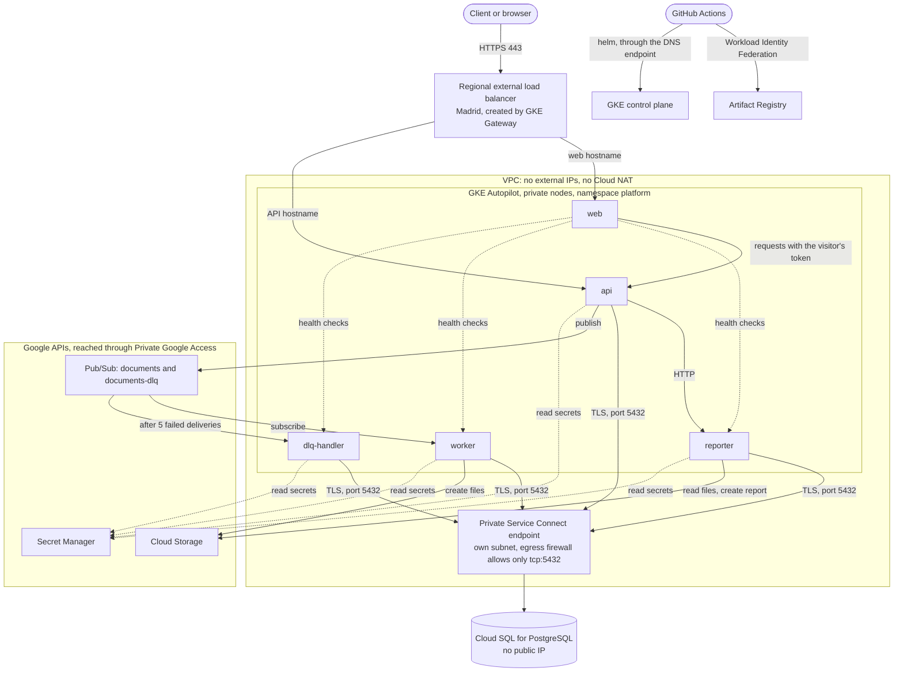

# Google Cloud platform with Terraform

[](https://github.com/oliverxyz/google-cloud-terraform/actions/workflows/ci.yml)

A private GKE Autopilot platform with five Python microservices, built with Terraform and
designed to be temporary: an environment comes up from nothing with one command, gets verified
end to end, and is deleted completely.

**Status:** the full up, verify and down cycle has been run on `dev`. `test` and `prod` are
configured with the same modules but have not been run yet; their sizes are listed under
[Environments](#environments).

## Architecture



Request flow:

1. `api` authenticates the request, stores a document revision in PostgreSQL and publishes a
   message with the document ID as its ordering key.
2. `worker` receives revisions in order, writes one file per revision to Cloud Storage and records
   the result in the database.
3. A message that keeps failing moves to the dead-letter topic after 5 deliveries, and
   `dlq-handler` marks the document as `failed`.
4. `api` calls `reporter` over internal HTTP. `reporter` reads the database and the files, then
   writes a summary file.

`web` is a console for the rest. Anyone can see whether each service is up. To send test requests,
a visitor types the API token into the page, and `web` forwards it to `api`, which checks it.

## Design decisions

| Decision | Reason | Alternative considered |
| --- | --- | --- |
| GKE Autopilot | Google manages the nodes and sizes them to Pod requests, which suits short sessions | Zonal Standard: more control over nodes, and more to manage |
| Private Service Connect for Cloud SQL | Separates the database from the cluster network with a single firewall-controlled path | HA VPN between two VPCs: more literal separation, much more complex. Private services access: simplest, weakest separation |
| Direct connection on port 5432 | The Cloud SQL Auth Proxy would need port 3307 as well | Auth Proxy |
| `sslmode=verify-ca` | The endpoint is reached by IP and the certificate names a DNS host, so `verify-full` would need a private DNS zone | Private DNS zone with `verify-full` |
| No Cloud NAT | Images come from Artifact Registry and APIs through Private Google Access, so nodes need no internet | Cloud NAT: an extra path out of the network that nothing needs |
| Write-only Terraform arguments for secrets | Generated passwords never reach Terraform state | `random_password`: simpler, but the value stays in state |
| DNS endpoint for `kubectl` | IAM-authorized access with no bastion, and IP endpoints stay off | Bastion host or authorized networks |
| Subdomain delegated to Cloud DNS | The domain is registered with Cloudflare, which requires its own name servers, so only a subdomain can move | Records in Cloudflare managed by Terraform: needs an API token |
| API token typed into the web page | `web` holds no secret, so a public page cannot write anything by itself. The token lives only in the open tab | Token stored on the server: anyone could write to the system. Google login through IAP: visitors would need to be on a list |
| Deployer accounts limited by RBAC | Each account gets only connect access at project level, and its permissions exist in one namespace of one cluster | `roles/container.developer` on the project: would allow dev credentials to reach prod |
| GitHub Actions deploys, Terraform runs by hand | CI holds no infrastructure credentials and has no access to state | Terraform in CI: more automation, more risk in a public repository |

## Security

- **Network:** private nodes, no external IPs on nodes, no public IP on the database, and no route
  to the internet from Pods.
- **Database path:** the egress firewall allows only `tcp:5432` towards the database subnet.
  This was tested by disabling each rule in turn: without the allow rule port 5432 closes, and
  without the deny rule port 3307 opens. NetworkPolicies add default deny inside the namespace.
- **Identity:** Workload Identity everywhere and no service account keys. Each service has its own
  account, with roles granted on individual resources rather than on the project. `web` needs no
  Google access, so it has no Google account at all, and NetworkPolicies block its way to the
  database and to Google APIs.
- **Secrets:** Secret Manager with a replica in the deployment region only. Values are absent from
  Terraform state and from this repository. `db-admin-password` is readable by no service.
- **Public surface:** only `api` and `web` are exposed, on HTTPS only. All `api` endpoints except
  `/healthz` need a token. Requests are rate limited per client and bodies are limited to 128 KiB.
- **Web page:** without a token it shows only each service's name and state. It runs no inline or
  third-party code under a strict Content Security Policy, shows responses as text and forwards
  only a fixed list of `api` paths. The token is not stored by the browser or by `web`.
- **Containers:** non-root, read-only root filesystem, all capabilities dropped.
- **GitHub Actions:** third-party actions are pinned by commit SHA. Federation tokens are issued
  only for the `main` branch of this repository, checked by numeric owner ID.
- **Data location:** all data stays in `europe-southwest1`. The Pub/Sub topics also reject traffic
  received in other regions (`enforce_in_transit`).

## Repository layout

```text
bootstrap/              APIs, Terraform state bucket, DNS zone, GitHub Actions identity
modules/                database, deploy_config, gke, iam, ingress, network, queue, registry,
                        secrets, storage
envs/{dev,test,prod}/   Root configurations, identical except for values and the state prefix
services/               api, worker, dlq_handler, reporter, web, shared common package, tests
charts/platform/        Helm chart. env/<service>.yaml holds the environment of each service
scripts/                bootstrap.sh, up.sh, verify.sh, down.sh, deploy.sh, check-orphans.sh
.github/workflows/      ci.yml: checks only. deploy.yml: manual application deployment
```

## Prerequisites

Terraform 1.16, the gcloud CLI with `gke-gcloud-auth-plugin`, kubectl, Helm 4, Docker, Python 3,
and the GitHub CLI, signed in. Also an empty GCP project with billing enabled, and a signed-in
`gcloud auth login` and `gcloud auth application-default login` with the quota project set.

## Bring up from nothing

First time only. This creates what outlives environments, and removes the default VPC that
Compute Engine creates with SSH and RDP open to the internet:

```bash
./scripts/bootstrap.sh
```

Then, also once, add the four name servers from the `dns_name_servers` output as NS records for
the `cloud` subdomain in Cloudflare.

Every session:

```bash
./scripts/up.sh dev
```

```bash
./scripts/verify.sh dev
```

```bash
./scripts/down.sh dev
```

`up.sh` applies Terraform, grants the deployer its RBAC, then runs the `Deploy` workflow from
`main` and waits for it. To deploy the current checkout from your machine instead:

```bash
DEPLOY_LOCAL=1 ./scripts/up.sh dev
```

## Session checklist

- [ ] `./scripts/up.sh dev` finished successfully
- [ ] `./scripts/verify.sh dev` printed `RESULT: all checks passed`
- [ ] The demonstration is done
- [ ] `./scripts/down.sh dev` printed `RESULT: nothing left for dev`

`verify.sh` covers: HTTPS with a valid certificate, rejection without a token, port 80 not served,
ordered processing of revisions, one file per revision, the dead-letter path, the report, the
database port from inside a Pod, closed port 3307 and internet access, isolation between services,
the rate limit, and the web page: its security policy, the status of all services, requests with
and without a token, and that it cannot reach the database or the internet.

## Try it

While `dev` is up, the console is at `https://web.dev.cloud.oliverolsson.xyz`, and the API at
`https://api.dev.cloud.oliverolsson.xyz`. The token for both is read from Secret Manager:

```bash
TOKEN="$(gcloud secrets versions access latest --secret dev-api-token)"
```

```bash
curl -H "Authorization: Bearer $TOKEN" -H 'Content-Type: application/json' -d '{"title":"demo","content":"hello"}' https://api.dev.cloud.oliverolsson.xyz/documents
```

| Endpoint | Purpose |
| --- | --- |
| `GET /healthz` | Health check, no token needed |
| `POST /documents` | Create a document. `"simulate_failure": true` sends it to the dead-letter path |
| `POST /documents/{id}/revisions` | Add a revision |
| `GET /documents/{id}` | Status of a document |
| `POST /reports` | Build a report from the database and the files |

To administer the database, start a temporary Pod in the `platform` namespace with `psql`. The
connection goes to the endpoint IP on port 5432 with `sslmode=verify-ca`.

## Environments

Configuration is shared through modules. Environments differ only in these values and in their
state prefix, and they can run at the same time.

| | dev | test | prod |
| --- | --- | --- | --- |
| Cloud SQL machine | `db-f1-micro` | `db-g1-small` | `db-custom-1-3840` (1 vCPU, 3.75 GiB), HA |
| SSD | 10 GB | 10 GB | 20 GB |
| Backups | no | no | yes, in Madrid |
| Replicas per service | 1 | 1 | 2 |
| API hostname | `api.dev.cloud.oliverolsson.xyz` | `api.test.cloud.oliverolsson.xyz` | `api.cloud.oliverolsson.xyz` |
| Web hostname | `web.dev.cloud.oliverolsson.xyz` | `web.test.cloud.oliverolsson.xyz` | `cloud.oliverolsson.xyz` |
| Address ranges | `10.10.0.0/16` | `10.20.0.0/16` | `10.30.0.0/16` |

## Manual steps

- Signing in: `gcloud auth login`, `gcloud auth application-default login`, `gh auth login`.
- Adding the NS records to Cloudflare, once.
- Using this repository with another project: change `bootstrap/terraform.tfvars`, the
  `terraform.tfvars` and the backend bucket in `versions.tf` of each environment, and the project
  values in `.github/workflows/deploy.yml`.

## Assumptions and known limits

- Environments hold no data worth keeping, so deletion protection is off and buckets are force
  destroyed.
- `web` and `api` each apply the rate limit per Pod, so the effective limit grows with the replica
  count.
- Publishing happens after the database commit without an outbox. If it fails, the client gets
  `502` and the revision stays unprocessed.
- A revision that reaches the dead-letter topic blocks later revisions of the same document, and
  they follow it there. Other documents are unaffected.
- Order is guaranteed per ordering key only. Messages in the dead-letter topic may be out of order.
- The schema is created at service startup under an advisory lock. A real project would use a
  separate migration step.
- A new certificate reaches the load balancer proxies gradually, so TLS errors are possible for a
  short time after it becomes active. `verify.sh` waits for a stable result.
- Not covered by automated checks: ordering across redeliveries, and the rate limit with several
  replicas. The firewall rule test was a manual one-time check and is not part of `verify.sh`.
- Direct image and package downloads happen on the build machine, never inside the cluster.
- Running `up.sh` deploys what is on `main`, not the local checkout, unless `DEPLOY_LOCAL=1` is set.

## Development

```bash
cd services && pip install -r requirements.lock -r requirements-dev.txt && ruff check . && pytest
```

```bash
helm lint charts/platform --values charts/platform/ci/test-values.yaml
```

```bash
terraform fmt -recursive -check
```
